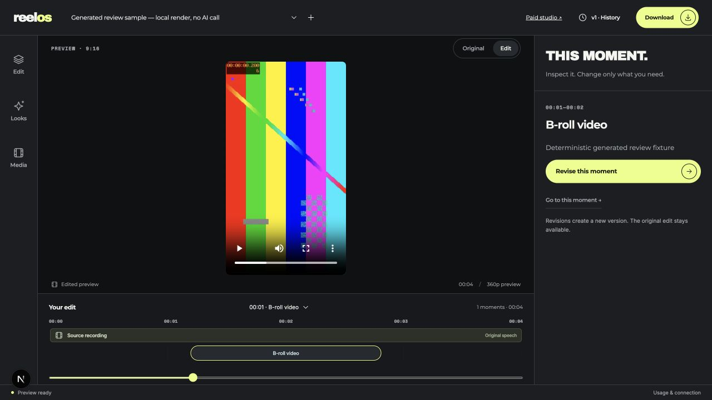

# ReelOS Studio — creative jobs paid on NEAR

[](https://github.com/Thirumurugan-12/reelos-near-studio/actions/workflows/verify.yml)

ReelOS connects an AI-assisted video editor to client-approved native NEAR escrow.
A customer funds an immutable brief, the studio publishes the MP4's SHA-256, and
only the funding customer can release the editing payment. The customer can reclaim
an unreleased editing payment after the deadline. The separate storage fee is retained.

**Tracks:** Agent Economy, Real-World Money, Open Innovation. **Prototype:** controlled, single-user, NEAR testnet.
Provider delivery is manually signed. The contract retains an upgrade key.

[Watch the 66-second public demo](https://x.com/blu_esense/status/2119733707791876185) · [Public transaction evidence](#public-near-evidence)

## Start here: reproduce the app without keys

Requires macOS Apple Silicon or Linux x64, Bash, **Node 22**, **Python 3.12+ / uv**,
**FFmpeg** and **ffprobe** on PATH. Install tools from their official distributions.
The first run downloads locked dependencies and a browser runtime for graphics tests.
No `.env`, Meta account, testnet wallet, private footage or signing key is required.

```sh
git clone https://github.com/Thirumurugan-12/reelos-near-studio.git
cd reelos-near-studio
./scripts/verify.sh app
./scripts/reviewer-demo.sh
```

The first command installs locked dependencies, runs backend/frontend checks and
builds the frontend. The second generates a four-second source and moving cutaway,
uploads them through the real API, and queues real preview and **1080×1920 MP4 export**
jobs. It prints a project URL at **http://127.0.0.1:3102/**. Open it to play, inspect
the timeline, compare source/output and download the export. Ctrl+C stops the demo.
Its isolated temporary directory and logs are printed; existing projects are untouched.

Expected results: **259 backend tests**, **13 frontend tests**, passing Ruff,
TypeScript and production build; a generated project with a playable preview,
export digest and zero model calls. See [verification map](docs/REVIEWABILITY.md).
The generated demo uses a manual timeline and calibrated tones; it does not
represent fresh AI planning or SAM inference. The AI workflow requires your own
working Meta credentials and an intentionally enabled budget.



## Run the NEAR contract locally

Requires the official **Rust 1.92.0** toolchain with `rustfmt`, `clippy` and
`wasm32-unknown-unknown`, plus Node 22. The pinned Sandbox supports Apple Silicon
macOS and Linux x64. Installation needs network access; the scenario uses only local
Sandbox accounts, signatures and balances.

```sh
rustup toolchain install 1.92.0 --profile minimal --component rustfmt --component clippy --target wasm32-unknown-unknown
rustup default 1.92.0
./scripts/verify.sh contract
```

Expected: **28 contract unit tests**, formatting/Clippy, release Wasm build and the
compiled-Wasm Sandbox scenario pass. The scenario executes deployment, funding,
unauthorized-action rejection, delivery, native payout, duplicate rejection and
deadline refund. Run `./scripts/verify.sh` for both app and contract checks.
[Contract methods](contracts/reelos-escrow/README.md) · [Sandbox details](contracts/sandbox/README.md).

## Public NEAR evidence

Contract **`reelos-escrow-20261109.testnet`**, studio **`thirumurugan12.testnet`**,
separate customer **`reelos-demo-client-20261109.testnet`**. Price **0.1 NEAR** +
**0.02 NEAR retained storage**; gas extra. Public state finalized as **paid**.

| Step | Public transaction |
| --- | --- |
| Deploy and initialize | [HehvqR2n…](https://testnet.nearblocks.io/txns/HehvqR2nvW6aD2QJPu23AEDp5EWeAhjZav9MXVWznuSh) |
| Customer funds 0.12 NEAR | [6JSmQc96…](https://testnet.nearblocks.io/txns/6JSmQc96HwwMYYF8WnfDmvj5Vr9hphPqa1qsjqFPS1Hc) |
| Studio publishes export digest via Meteor | [CT4YtFQm…](https://testnet.nearblocks.io/txns/CT4YtFQmSN29ZGqHTGT4Wqa2f8UxZih9GXvNxqKT2c5E) |
| Customer approval → native 0.1 NEAR transfer to studio | [AKZdntwS…](https://testnet.nearblocks.io/txns/AKZdntwS8Y7eEKwHDBoAcNgNaPCwgbfEvUsxsBpMvKwA) |

[Exact IDs, digest and read-only reproduction](docs/NEAR_REHEARSAL.md) ·
[Machine-readable evidence](docs/evidence/near-settlement.json).
This public rehearsal settles an existing edited MP4. A **fresh payment-triggered
public AI render remains unverified**. Local integration tests use chain/model
responses as test doubles and execute the real renderer.

## Architecture and where to inspect

```text
Customer wallet → native NEAR escrow → finalized RPC verification
                                          ↓
                               immutable brief + durable job
                                          ↓
                              editor / renderer → MP4 SHA-256
                                          ↓
Provider wallet → delivery digest → customer approval → native payout
```

| Component | Source | Verification |
| --- | --- | --- |
| Price, caller authorization, deadline, transfer recovery | [Rust contract](contracts/reelos-escrow/src/lib.rs) | Rust tests + compiled Sandbox |
| Finalized testnet state, fixed RPC boundary | [NEAR reader](backend/reelos/near.py) | [RPC tests](backend/tests/test_near.py) |
| Immutable brief, matching payment, one dispatch | [Paid-job API](backend/reelos/orders.py) | [Order integration tests](backend/tests/test_orders.py) |
| Timeline validation, project-scoped moving cutaways | [Timeline](backend/reelos/timeline.py), [decoder](backend/reelos/footage.py) | [Moving footage/audio tests](backend/tests/test_footage_insert.py) |
| Wallet review and signing | [Paid studio](frontend/app/orders/page.tsx), [wallet adapter](frontend/lib/near-wallet.ts) | Frontend tests + public Meteor delivery receipt |
| Reproducible generated editor/export | [Demo tool](backend/scripts/reviewer_demo.py) | [Credential-free integration test](backend/tests/test_reviewer_demo.py) |

The backend holds **no wallet signing keys**. Onchain data contain payment terms
and hashes, not videos or editing instructions. Payment release is customer-approved;
it does not judge creative quality, resolve disputes or prove copyright ownership.
SQLite records durable jobs; failed work is not automatically replayed against paid APIs.

## What is new for this hackathon

We reused the earlier Meta hackathon editor at **`2ddb6d1`**. New work adds the
Rust escrow, Meteor controls, finalized RPC verification, paid-job dispatch,
CLI deployment/activation, `/orders`, settlement proof, moving supporting video,
and the credential-free review path. Inspect `git diff 2ddb6d1..HEAD` (full history
is retained). The earlier editor and third-party recipe attribution are documented
in [editor baseline](EDITOR_BASELINE.md) and [dependency/media inventory](docs/DEPENDENCIES.md).

## Limitations and further setup

- Single-user local workspace; no public multi-tenant deployment or authentication.
- AI inference needs working Meta credentials. Default example budget is zero.
  Generated review media remain independent of external providers.
- Provider delivery is manual; retained deployment key makes testnet escrow upgradeable.
- Native NEAR only; no NEAR Intents, confidential inference or autonomous treasury claim.
- Private source footage, `.env`, generated media and local CLI keys are excluded from Git.
  `/rehearsal` requires the private local manifest; public reviewers use the linked
  receipts and generated demo instead.
- The public demo is linked above. The hackathon submission form remains a draft.

For your own real AI/NEAR workflow: [setup](docs/NEAR_SETUP.md),
[paid-job scope](SPEC-near-paid-jobs.md), [current evidence](docs/NEAR_VERIFICATION.md),
[video provenance](docs/NEAR_DEMO.md). Historical Docker/development instructions
and editor features are in [EDITOR_BASELINE.md](EDITOR_BASELINE.md).
