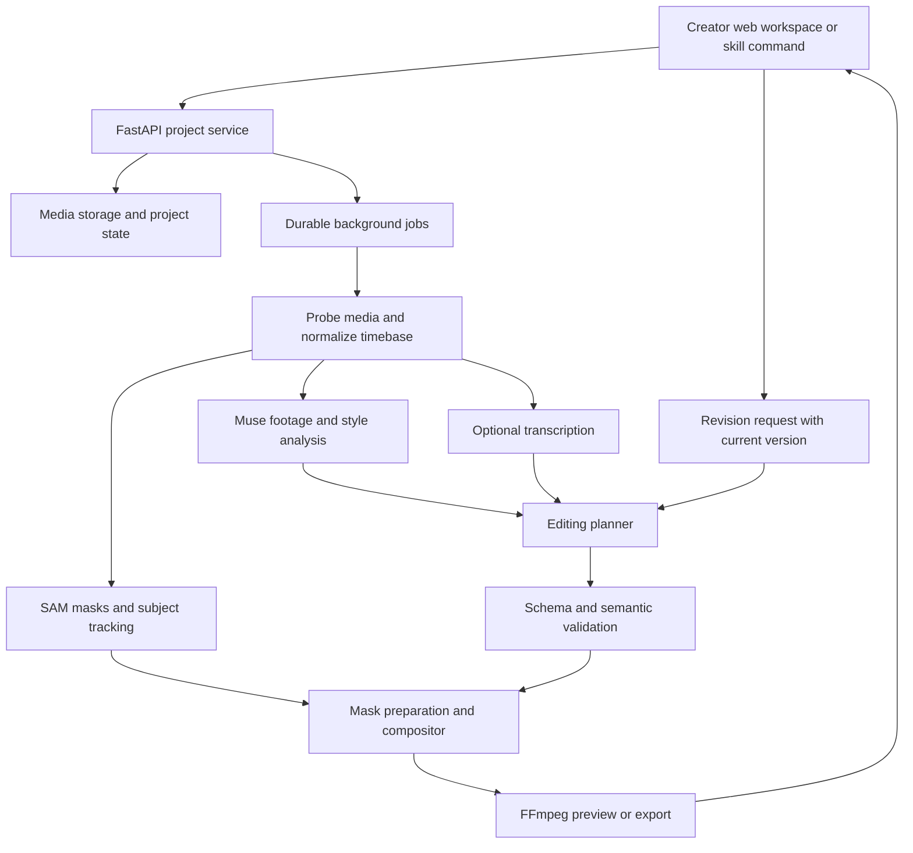

# ReelOS — Project Initiation Document

**Version:** 0.3 · **Prepared:** 26 October 2026 · **Owner:** Thirumurugan

**Purpose:** Define the product, execution boundaries, evidence, and submission package for the Meta AI Developer Hackathon. PID means Project Initiation Document here; this document includes product requirements and an implementation brief.

**Status:** Proposed build baseline. No implementation, API access, acceptance into the event, or user-validation results are implied by this document.

**Positioning:** An AI creative director that turns a creator's footage and visual inspiration into an actual edited video, then revises it through conversation.

**Demo promise:** “Give ReelOS a talking-head clip and a reference. It adapts supported editing patterns, puts graphics behind the real subject using Meta SAM, and lets you refine the result in plain language.”

## 1. Executive summary

ReelOS helps solo creators turn a recorded idea into a finished short video without manually managing masks, layers, effect timings, and export settings. A creator uploads footage, optionally supplies a reference, and describes the desired result. Muse Spark interprets the footage and reference and proposes a structured edit. SAM 3.1 isolates and tracks the chosen subject. A deterministic effects engine executes the approved operations and exports an MP4. The creator can say “make the opening faster” or “move the headline lower,” receive a new version, and compare it with the previous edit.

The hackathon build concentrates on 15–30 second portrait talking-head videos and three effects that visibly benefit from segmentation. Its technical contribution is the connection between creative intent, validated editing operations, persistent subject identity, compositing, and controlled revisions. A reusable command interface will expose the same workflow as a skill; a small web interface makes the result approachable and demonstrable.

The original ReelOS ambition includes multi-clip creative direction and broad reference matching. This release deliberately proves that ambition with a narrower supported workflow. Additional clip selection, music synchronization, and effects only enter after the core workflow passes its quality gates.

**Success means:** An unfamiliar creator completes a first edit and a specific revision; the output visibly demonstrates SAM; the system works on footage beyond the main demo; and the submission presents evidence against the judging rubric. Winning is an objective, not a guaranteed outcome.

## 2. Problem and evidence

### Problem statement

A solo creator knows the message they want to communicate and can point to an editing style they like, but translating that intention into cuts, readable typography, tracked graphics, and polished output requires several separate editing skills. A description such as “make this cinematic” does not solve the work unless it becomes executable editing decisions.

**Job to be done:** “When I finish recording a short explanation, help me turn it into an engaging reel in the style I have in mind, while letting me correct specific decisions without rebuilding the edit.”

### Evidence available

- The user's Creedom experience provides firsthand context in creator analytics, multimodal video analysis, asynchronous processing, and production AI systems. This is founder context, not independent demand validation.
- The inspected `claude-video-effects` project demonstrates a concrete implementation pattern: natural-language requests become effects JSON, Python draws effects, computer vision supports tracking/cutouts, and FFmpeg exports video. [S1–S3]
- Meta documents complementary scene understanding and video segmentation capabilities. [S4–S6]

**🔶 Assumption:** Creators value a controllable first edit enough to adopt the workflow. We have no measured editing-time baseline, retention data, willingness-to-pay results, or independent user interviews yet.

### Validation before polishing

Recruit three creators, ideally including two outside the builder's immediate development circle. Ask each to bring a short recording and a style reference. Observe one editing task, record active editing time, and ask which decisions they most want help with. Test the prototype with the same people. Preserve exact quotes only with permission; report the small sample honestly.

## 3. Users and strategic focus

| User | Need | Release priority |
|---|---|---|
| Solo educator, founder, or talking-head creator | Finish a clear short video with strong visual emphasis | Primary |
| Freelance editor | Accelerate masks, tracked graphics, and first drafts | Secondary; collect feedback |
| General filmmaker or agency team | Multi-camera editing, collaboration, complex audio | Future scope |

The primary persona is a proposed target, not a researched demographic profile. The theme recommendation is **Build for Your World**, based on the user's creator-workflow experience. Confirm the available theme and submission fields in the actual portal.

The benchmark is the creator's current workflow and the inspected effects skill. We will not claim that ReelOS is the first conversational editor or that competitors lack reference matching without further research.

## 4. Hackathon strategy and constraints

The following weights and terms come from the user's pasted earlier rules review. The official details page could not be retrieved during this document's preparation. Treat these as a provisional planning baseline and recheck the linked official rules before submission. [S9]

| Criterion | Reported weight | Product evidence we will present |
|---|---:|---|
| Impact | 30% | A concrete creator task; observed baseline and prototype time; creator feedback |
| Use of Meta AI tooling | 25% | Muse-generated decisions; SAM masks and tracked subject; one visible example of each contributing to the result |
| Demo | 25% | Raw clip → edited result → requested revision → changed result |
| Technical depth and execution | 20% | Validated timeline, temporal masks, compositing, version history, failure recovery, measured runs |

**Reported deadline:** 4 November 2026, 9:00 PM ET, equivalent to **5 November 2026, 7:30 AM IST** if the reported time is correct. Internal submission target: **4 November, 6:00 PM IST**. All dates below use IST.

**🔵 Open questions:** Official submission fields, video duration, repository visibility requirements, treatment of existing code, permitted supporting providers, team eligibility, acceptance, and credit activation must be verified. The earlier review reported an Indie Dev team limit of four and $150 in credits for selected participants; neither is assumed activated for this project.

The earlier rules summary also described ownership and organizer licence terms. Review the current official terms before including any private footage, employer assets, or unpublished intellectual property. This PID does not substitute for the rules.

### Differentiation to demonstrate

1. **Creative choices:** The system explains a few concrete timing and emphasis decisions using footage evidence.
2. **Subject-aware execution:** Text or graphics move behind the actual tracked subject rather than covering them.
3. **Controlled revision:** A request changes specific parameters while preserving the rest of the edit.
4. **Inspectable output:** The user receives a playable MP4, version history, and the structured edit plan.

Changing providers or renaming an existing skill is insufficient as the core contribution. Disclose reused components and show the new planning, subject handling, and revision work.

## 5. Product scope

### Release boundaries

| Dimension | Hackathon commitment |
|---|---|
| Main input | One talking-head video, initially capped at 60 seconds |
| Reference | Zero or one uploaded reference, initially capped at 30 seconds |
| Output | One 15–30 second 9:16 video; shorter input may produce shorter output |
| Input formats | MP4/MOV if installed decoders support the actual codecs |
| Initial upload cap | Proposed 200 MB per file; enforce server-side and revise after host testing |
| Subjects | One selected primary person; another person triggers selection rather than silent guessing |
| Languages | English for judged path; other languages only after explicit testing |
| Export | 1080 × 1920 H.264 MP4 with AAC audio; 30 fps |
| Preview | Lower-resolution render using the same timeline and transforms |
| Interaction | Prompt → draft → preview → revise → export |
| Skill interface | Local CLI/tool interface sharing the web app's validated engine |

These are engineering scope decisions, not advertised model limits. Broad codec support and large-file behavior remain dependent on the selected host.

### Must deliver: P0

- Media upload, metadata inspection, playable source preview, and actionable errors.
- Muse footage understanding and a valid, supported editing plan.
- SAM subject masks with temporal association and visible compositing.
- Three effects: behind-subject headline, subject spotlight, tracked label/outline.
- Trim and optional simple punch-in; retained source speech.
- Preview and downloadable final export.
- At least three supported revision intents, immutable versions, and restore.
- Evidence panel with source observations, selected effects, and changes between versions.
- Reusable style parameters for the three effects and a beat/storyboard summary derived from the validated plan.
- A runnable command workflow and documented skill/tool instructions using the same engine.

### Target differentiator: P1

- Reference analysis that maps observed pacing, text placement, and emphasis to supported operations.
- Reference and footage observations contain supporting timestamps and explicit uncertainty.
- Phrase-timed emphasis using transcription turn boundaries.
- One optional B-roll insert if the core pipeline is stable.

Reference analysis is important to the full product story. If it fails its quality gate, retain prompt-driven editing, describe the reference feature as incomplete, and adjust the pitch accordingly.

### Stretch: P2

- Exact word alignment, captions, beat-aware cuts, two additional effects, up to five raw clips, and automatic subject-centered reframing.
- Optional generated graphic assets using an available Meta image model.

### Excluded from this release

Full nonlinear editor, arbitrary visual-effect generation, unrestricted reference cloning, 3D scene reconstruction, video generation, social publishing, payment, multi-user collaboration, voice cloning, mobile apps, and real-time export. These exclusions protect time for rendering quality and the core demo.

## 6. User journey and interface

1. **Create:** Upload footage and optionally a reference. See duration, thumbnail, and the supported output.
2. **Direct:** Enter a goal or choose “Bold explainer,” a predefined style specification. A preset remains clearly identified as a preset.
3. **Choose subject:** If necessary, click the intended person in a frame. Preview the selection.
4. **Analyze:** See named stages: inspecting footage, understanding style, tracking subject, planning edit, rendering preview. Display actual stage progress rather than invented completion estimates.
5. **Storyboard and draft:** Inspect the beat table derived from the validated plan and play the draft. If the creator explicitly selected storyboard review mode, wait for Render draft before rendering. Otherwise generate the preview automatically. Show three concise explanations and a lightweight effect/timing strip.
6. **Refine:** Request a supported change. See a change summary and a new preview.
7. **Compare and export:** Switch between versions, restore an earlier one, and download the final MP4 and plan.

Use one workspace: source/reference assets on the left, player in the center, direction and revision panel on the right, version strip below. On narrow screens stack these areas. A timeline strip exposes effect timing without committing to a drag-and-drop editor.

State must remain clear: idle, processing, needs subject selection, draft ready, rendering export, failed, and complete. Keyboard access, visible focus, labelled inputs, readable contrast, and status announcements are acceptance requirements. The user should not encounter model names, storage paths, or queue details unless they open technical evidence.

## 7. Functional requirements and acceptance criteria

| ID | User requirement | Acceptance criterion | Priority |
|---|---|---|---|
| R01 | Upload my recording | Supported file passes decoder/metadata checks; invalid/oversized file receives a specific error; original is preserved | P0 |
| R02 | Describe the desired edit | Prompt and chosen constraints are stored with the project; model receives only relevant context | P0 |
| R03 | Get useful footage analysis | Observations reference valid source ranges; missing or uncertain observations are marked; no guessed metrics are presented as fact | P0 |
| R04 | Select the intended subject | Primary subject has an internal ID; ambiguous/no-match results require selection or correction; identity is maintained over the chosen shot | P0 |
| R05 | Put a headline behind me | Headline is visible in background regions and occluded by the foreground subject at inspected frames | P0 |
| R06 | Emphasize me with lighting | Background darkening follows the subject mask; intensity stays bounded; source pixels remain recognizable | P0 |
| R07 | Attach a graphic to a subject | Anchor derives from tracked geometry, is smoothed, and stays within safe frame bounds | P0 |
| R08 | Get an actual edited video | Valid plan renders to playable MP4 with expected dimensions, duration, and retained speech | P0 |
| R09 | Refine the result | “Move headline lower,” “reduce spotlight,” and “make intro faster” alter documented fields; unrelated fields remain unchanged | P0 |
| R10 | Undo and compare | New edit creates a version; prior plan/output remains retrievable; restoring does not delete later versions | P0 |
| R11 | Understand the edit | Display supported reasons and changed operations; show warnings for approximated effects | P0 |
| R12 | Run it as a skill | A documented command/tool sequence analyzes, plans, validates, previews, and renders; it shares schemas with web workflow | P0 |
| R13 | Adapt a reference | Model reports observable style attributes with timestamps and maps them to allowed effects; unsupported features are identified | P1 |
| R14 | Time emphasis to speech | Turn-level timing is labelled accordingly; exact-word claims require independently verified alignment | P1 |
| R15 | Insert supporting B-roll | Insert references an uploaded asset and valid range; source speech continuity and output duration remain valid | P1 |
| R16 | Inspect my storyboard | Beat table contains source/output intervals and operation IDs from the validated plan; explicit review mode defers rendering until requested | P0 |
| R17 | Reuse a visual style | Preset, reference proposal, and user overrides resolve deterministically; resolved font, palette, layout, and motion values are frozen per version | P0 |

**Edge behavior:** No detected person must not produce an empty foreground silently. Subject disappearance suppresses attached graphics rather than pinning them to arbitrary positions. A cut resets tracking. A silent clip remains supported for visual effects. Unsupported requests receive the nearest supported option with a clear explanation. A failed revision leaves the previous playable version intact.

## 8. Meta model responsibilities and limitations

| Component | Role | Output and verification |
|---|---|---|
| Muse Spark | Understand footage/reference; propose edits and revisions | Text/structured proposals validated against schema, supported effects, and source timing |
| SAM 3.1 | Detect, segment, and track the chosen subject | Boxes/masks decoded and checked for frame coverage, identity continuity, and plausible geometry |
| Muse Voice Transcribe, if access works | Speech text and utterance timing | Turn timestamps; transcript spot-check against audio |
| Optional local face detector | Precise head/face anchor | Supplementary geometry; not a substitute for SAM in the claimed segmentation feature |
| Python compositor and FFmpeg | Execute animations, masks, cuts, and encoding | Reproducible output from a frozen plan and cached analysis |

SAM is a perception model, not the animation engine. Segmentation provides visibility masks; graphic motion, typography, easing, and layering still require code. Subject segmentation is not facial landmark estimation, 3D pose, or hair matting. Mask refinement and temporal smoothing must be assessed on real footage. [S4–S5]

Muse Spark supports video understanding, but its semantic timestamps are proposals requiring validation. Current documentation warns that audio understanding in Spark 1.3 is not fully supported; keep transcription separate and verify the selected model version before integration. [S6]

Muse Voice Transcribe provides turn-level timestamps rather than word timestamps. “On this exact word” therefore needs a separate forced-alignment step. Use utterance timing for the baseline and defer exact word effects unless alignment proves reliable. [S7]

Model identifiers, account access, media limits, latency, pricing, and provider terms must be recorded from a successful smoke test. Pin tested configuration; do not select models solely from their names.

## 9. System architecture



### Recommended implementation

- **Frontend:** Next.js/React with a restrained component library, native video player, revision panel, and version selector.
- **API:** FastAPI with Pydantic schemas and explicit project, asset, version, and job objects.
- **Worker:** Python compositor, FFmpeg/ffprobe, OpenCV, NumPy, Pillow; Redis/Celery for jobs if the team can establish them quickly.
- **State:** PostgreSQL for durable records; local project storage for initial single-user development. Use private object storage only if deployment requires it.
- **Deployment:** One controlled demo environment; CPU rendering first, hosted SAM API where available. GPU self-hosting is a contingency requiring its own access/runtime test.

**🔶 Assumption:** Existing FastAPI/Celery experience makes this stack faster than introducing a new orchestration framework. If durable queue setup takes more than half a day, use one worker process with persisted job records and resume support; preserve interfaces so it can be replaced.

### Data objects

`Project` stores owner/session, constraints, status, asset IDs, and current version. `Asset` stores immutable local/object-storage references, hash, media metadata, rights note, and provider file mapping. `Analysis` stores model/version, prompt version, observations, and source timing. `SubjectTrack` stores shot ID, subject ID, frame/timestamp mapping, masks, and geometry. `EditVersion` stores parent ID, instruction, canonical plan, validation result, and output references. `Job` stores stage, attempt, timestamps, error category, and resumable artifact references.

### Durable job behavior

Use project/version hashes for idempotent rendering. Cache source analysis and SAM output by asset hash plus model/prompt/configuration. Reuse masks for text-position or effect-intensity revisions. Retry transient provider/network failures with bounded backoff; do not repeat a failed validation as a provider request indefinitely. Job cancellation stops future stages and terminates renderer subprocesses safely. Preserve useful artifacts after recoverable failures.

## 10. Editing contract

The planner proposes data, never arbitrary executable renderer code. The following illustrative plan shows the intended contract; implementation must formalize it before planner integration.

```json
{
  "schema_version": "1.0",
  "project_id": "demo_project",
  "version_id": "v2",
  "parent_version_id": "v1",
  "output": {"width": 1080, "height": 1920, "fps": 30},
  "clips": [
    {"id": "shot_1", "asset_id": "raw_1", "source_in": 2.0,
     "source_out": 22.0, "timeline_start": 0.0, "speed": 1.0}
  ],
  "effects": [
    {"id": "headline_1", "type": "behind_subject_text", "shot_id": "shot_1",
     "start": 0.4, "end": 3.2, "subject_id": "person_1",
     "params": {"text": "MAKE IT COUNT", "x": 0.5, "y": 0.26,
                "scale": 0.8, "color": "#FFFFFF"}}
  ],
  "audio": {"mode": "preserve_source", "gain_db": 0},
  "decisions": [
    {"operation_id": "headline_1", "reason": "Emphasize the opening claim",
     "evidence": {"asset_id": "raw_1", "source_start": 2.0, "source_end": 5.2}}
  ]
}
```

### Contract rules

- Source ranges use seconds in the normalized source timebase; effect ranges use output timeline seconds. Intervals are half-open. Coordinates are normalized to the output canvas.
- Output duration is derived from clips; source interval length divided by speed determines clip duration. Effects must fit their assigned shot's output interval.
- Timebase conversion is centralized. Apply source timestamp → output timestamp mapping after trims and speed changes; query the matching source mask rather than assuming frame indices still align.
- Validate asset existence, finite numbers, duration bounds, unique IDs, known subject references, supported enum values, text limits, safe positions, and operation ordering.
- P0 permits one video clip, speed 1.0, and no overlaps. “Faster intro” initially means tighter leading trim and shorter opening effect durations; speech speed manipulation is deferred.
- Define composition order: base source → background treatment/graphics → masked foreground → foreground labels. Reuse the identical order for preview and export.
- Freeze font files, random seed if used, effect implementation version, and model analysis references. Re-rendering the same frozen plan must not call a model again.
- Reject unknown effects. Permit one bounded repair attempt using validation errors; if repair fails, preserve the previous valid edit and surface the unsupported request.

### Style parameters and storyboard

Separate reusable font, palette, safe-margin, layout, and animation parameters from source timing. Reference analysis may propose these values with evidence and uncertainty; it must not claim exact recovery of hidden settings. Convert frame-based recipe timing through an explicit frame rate. Derive the readable storyboard from the canonical validated plan to prevent divergence. See [the supplied guide analysis](EFFECTS_GUIDE_ANALYSIS.md) for the recipe mapping and a bounded renderer comparison; the Python/FFmpeg baseline remains unchanged.

### Revision behavior

Resolve the request against the current version, propose a small patch, validate the resulting whole plan, and create a new version. Explicit fields are preserved unless the request requires changing them. A “move text lower” revision changes text position, not clip order or headline wording. If a requested change has no compatible operation, return a clear limitation rather than pretending it succeeded.

## 11. Effects engine and skill packaging

The [creative editing specification](CREATIVE_EDITING_SPEC.md) incorporates the supplied guide into the product workflow, style system, catalog, revision intents, and acceptance gates. Its fourteen sections map to a storyboard feature and thirteen effect entries; ReelOS also retains its subject spotlight. The three effects below remain P0. The larger catalog is a staged roadmap, and planners may select only implemented entries with satisfied dependencies.

| Effect | Input | Core implementation | Failure policy |
|---|---|---|---|
| Behind-subject headline | Text, timing, subject mask | Draw animated text, then restore masked subject above it | If tracking is unusable, offer a conventional foreground headline and disclose the fallback |
| Subject spotlight | Subject mask, intensity | Darken/desaturate background with feathered boundaries | Suppress effect if mask is missing; retain original frame |
| Tracked label/outline | Subject box/mask, anchor, text | Smooth geometry; clamp label to safe region | Fade out on subject loss; reacquire only with validated identity |

Make mask quality inspection an explicit development tool. Store a few diagnostic mask overlays and inspect entry, midpoint, exit, motion, and occlusion frames. Apply bounded smoothing and feathering only when they improve results; avoid trails that reveal earlier subject positions.

The skill package is portable instructions plus a tool/CLI adapter. It is not itself a new Meta-hosted assistant product. No documented “Samus skill” runtime has been established in the conversation; use the working name **ReelOS Effects Skill** until a target host is selected.

Proposed commands: `inspect`, `analyze`, `segment`, `plan`, `validate`, `preview`, `revise`, and `render`. Commands accept project/asset IDs or local paths through controlled resolution, return structured status, and call the same pipeline as the web app. A skill host may be any compatible coding agent; judged editing decisions and claimed Meta features must have observable Meta execution.

The inspected reference repository separates its skill instructions, effects renderer, and speech-timing script. Adapt reusable primitives where appropriate, retain notices, record the upstream commit, and document modifications. Its MIT licence requires preservation of the copyright and licence notice; bundled fonts and model assets have their own notices to review. [S1–S3, S8]

## 12. Delivery plan and ownership

**🔶 Assumption:** One primary builder is available for approximately 6 focused hours per day, roughly 54–60 hours through 4 November. This is a planning estimate, not a commitment. Thirumurugan owns product decisions and integration; other roles remain unassigned. If teammates join, assign renderer/vision, frontend, and validation/demo responsibilities explicitly.

| Date, IST | Deliverable | Gate to move forward | Indicative effort |
|---|---|---|---:|
| Oct 26 | PID, rights-cleared demo assets, account/rules checklist | Small real Muse and SAM requests succeed; constraints recorded | 4h |
| Oct 27 | Canonical schema, media probe, manual edit/render | A manual plan exports a playable portrait clip | 6h |
| Oct 28 | SAM integration and compositing | Behind-subject headline works on a moving person, with inspected masks | 6h |
| Oct 29 | Muse analysis/planner, validator | Prompt generates supported edit without manual JSON repair | 6h |
| Oct 30 | Revision/versioning, other two effects | Three targeted revision intents work and restore preserves versions | 6h |
| Oct 31 | Thin web workflow and skill adapter | Upload → first draft → revision → export completes in the interface | 6h |
| Nov 1 | Reference mapping experiment and integration | One observed reference pattern produces a visible supported operation | 5h |
| Nov 2 | Independent footage tests, creator sessions, hardening | Success metrics measured; major failures fixed | 6h |
| Nov 3 | Freeze scope, rehearse, record demo | Three consecutive main-demo runs; submission narrative and evidence ready | 6h |
| Nov 4 | Final verification and submission buffer | Portal artifacts and access verified; target submit by 6 PM IST | 4h |

Dependency order is rendering → segmentation → planning → revision → interface → reference refinement → evaluation and submission. Work can overlap only when interface boundaries are stable. Do not spend the first days building a dashboard before the renderer works.

### Go/no-go and cuts

- **Oct 26 access failure:** Test the documented supported deployment alternative within a fixed timebox. If no Meta execution path works, escalate the blocker immediately; do not disguise a different model as Meta.
- **Oct 28 segmentation failure:** Simplify lighting/background and effect type; retain a visible SAM feature. If segmentation remains unusable on ordinary footage, reassess the central demo rather than promising it.
- **Oct 30 schedule slip:** Drop B-roll, exact-word alignment, extra effects, music, and reframing. Keep a basic CLI path while the thin UI catches up.
- **Nov 1 reference failure:** Ship prompt-directed editing with an honest reduced claim. Do not label a preset as extracted reference style.
- **Nov 2 quality failure:** Freeze all feature additions and fix the dominant failure category.

## 13. Success metrics and evaluation

All numbers below are proposed release targets, not observed performance or model guarantees. Capture the machine, provider/model version, asset set, and cache state with every measurement.

| Metric | Proposed target | Measurement |
|---|---|---|
| End-to-end reliability | At least 9 successful runs out of 10 supported attempts | Upload through downloadable output; include failure reasons |
| Demo reliability | 3 consecutive successful rehearsals | Fresh project each time; distinguish cached analysis |
| Useful first draft | At least 2 of 3 creators say they would keep/edit the draft further | Standard question plus reasons; report sample size |
| Targeted revision correctness | At least 8 of 9 scripted revision trials | Three supported intents across three footage sets; inspect changed and preserved fields |
| Cold first preview | Aim ≤180 seconds for a 20-second output | Server acceptance to playable preview, upload excluded; report actual values |
| Warm revision preview | Aim ≤60 seconds | Reused analysis/masks; start at request acceptance |
| Foreground compositing | No major subject occlusion error in 10 sampled frames per main clip | Inspect boundaries, movement, head, and effect entry/exit; inspect full playback for flicker |
| Speech synchronization | Within 100 ms on designated checks | Beginning/middle/end of output; verify source/output mapping |
| Active creator time | Aim ≥50% reduction on the same task | Compare observed task baseline and assisted workflow; include unsuccessful tasks |

### Test footage

Use at least three rights-cleared sets: a clean stationary explainer, a moving speaker with hand gestures, and a more difficult background or temporary occlusion. Add a two-person ambiguity clip, no-person clip, silent clip, corrupt file, and unsupported request as targeted edge cases. Avoid claiming general robustness from one curated recording.

### Evaluation layers

1. **Contract checks:** Invalid times, missing assets, unsupported effects, unknown subject, oversized text, and out-of-range parameters are rejected.
2. **Rendering checks:** Known synthetic color blocks verify trim order, timing, mask layering, and output geometry. This tests meaningful behavior rather than JSON serialization alone.
3. **Revision checks:** Compare expected field changes and unrelated-field preservation.
4. **Perception checks:** Inspect actual subject masks, subject continuity, and artifacts across time.
5. **User task:** Observe completion without coaching and record where users hesitate.

Log per-stage latency, cache hit, job outcome, model configuration, validation repairs, and estimated cost. Keep raw footage and full prompts out of routine logs.

## 14. Resource and budget plan

**🔵 Open question:** Actual Meta credit availability and current pricing must be confirmed in the account. The prior event summary reported $150; this is a provisional ceiling, not confirmed funding.

If $150 is available, reserve $30 for final rehearsals and submission recovery. Allocate an initial $20 experiment cap for access, mask quality, and timing tests; release the remaining $100 incrementally only after measuring costs. These are allocation decisions, not per-model cost estimates. Require builder review before exceeding the available credit pool or buying GPU infrastructure.

Measure cost per analysis, segmentation request, and complete successful job. Record minimum billable units, retries, and repeated uploads. Estimate total spend from expected runs and measured costs. Cache aggressively and process only required source intervals while preserving enough context for tracking.

Other resources: a development machine with FFmpeg, private disk space for source/proxy/masks/export, a controlled hosted demo if feasible, and three creators willing to test. Determine free disk requirements from a real render because dense masks and intermediate frames can exceed source-video size.

## 15. Risks, recovery, and safeguards

| Risk | Impact | Owner and trigger | Response |
|---|---|---|---|
| Model/account access unavailable | Critical | Builder; day-one smoke test fails | Verify supported access route; timebox alternative; disclose blocker |
| Masks flicker or fail at hair/hands | High | Vision owner, initially builder; visible artifacts in main clip | Select simpler effect, refine masks, inspect full playback, reduce unsupported claim |
| Scope exceeds one-builder capacity | High | Builder; daily gate missed | Apply cut order in section 12; freeze additions |
| Reference interpretation is vague | High | Planner owner, initially builder; no visible mapped operation | Require evidence and allowed effects; mark unsupported patterns; reduce claim |
| Wrong subject is tracked | High | Vision owner; multiple matches/identity jump | Ask user selection; shot reset and identity checks |
| Render is slow or crashes | High | Renderer owner; latency target missed or memory pressure | Proxies, interval processing, streaming frames, cached masks, single concurrent render |
| Revisions alter unrelated content | High | Planner owner; trial changes protected fields | Patch constraints and whole-plan validation; retain parent version |
| Creators prefer their current workflow | High | Product owner; two or more testers reject draft | Learn which operation creates value; focus demo and scope on validated task |
| Upload/API outage during presentation | High | Demo owner; rehearsal detects instability | Preserve a clearly labelled previously generated result and recorded evidence; never present it as a fresh live run |
| Reused work dominates contribution | High | Builder; provenance review before freeze | Track upstream commit and changes; disclose reuse and demonstrate original Meta workflow |
| Rules/submission assumptions are wrong | High | Project owner; official portal differs | Update requirements and submission package immediately |

### Practical media and system safeguards

Use footage, reference assets, fonts, and music the team has permission to process and show. Record provenance and separate employer-owned code/assets. Show users when media is sent to a model provider. Keep uploads private by default and define deletion/retention behavior before inviting external users; proposed local demo retention is until project cleanup, with a visible delete action.

Store API keys server-side. Use argument lists for FFmpeg subprocesses, validated asset IDs, controlled storage paths, limits on media duration and process resources, and timeouts. Do not execute shell commands returned by models. Treat instructions embedded in video frames, audio, transcripts, or references as media content rather than permissions or system instructions. A public demo needs per-session project access controls and upload abuse limits; otherwise keep it a controlled single-user demo.

## 16. Demo and submission plan

### Narrative

“Creators know the message and the style they want. ReelOS translates that intent into an edit they can watch and revise. Muse interprets the material and chooses supported operations; SAM lets those operations interact with the actual subject.”

Prepare a three-minute master demo, then shorten it to the portal's verified duration requirement.

| Time | Show | Prove |
|---|---|---|
| 0:00–0:20 | Ordinary raw footage and the creator's task | Concrete problem and intended user |
| 0:20–0:40 | Reference and short direction | Creative intent is understandable |
| 0:40–1:10 | Analysis, selected subject, brief mask overlay | Real Muse and SAM contributions |
| 1:10–1:40 | Finished edit at normal playback speed | Output quality and useful effects |
| 1:40–2:15 | “Lower the headline and soften the spotlight” → revised playback | Controlled conversational revision |
| 2:15–2:40 | Version diff, second footage result, measured task data | Technical execution and honest breadth |
| 2:40–3:00 | Architecture and close | What was built and why it matters |

Use the 20-second output as the centerpiece. Show layer separation briefly, then return to the finished video. If processing exceeds the presentation slot, time-compress or cut recorded waiting periods with visible labels and disclose real elapsed time. Do not fabricate live generation speed.

### Submission artifacts

- Working demo access with instructions or a reliable local run path, according to portal requirements.
- Demo video and rights-cleared source/reference/result examples.
- Project description: problem, intended users, Meta model contributions, original work, and limitations.
- Repository access in the form actually required by the event; public availability remains unverified.
- Setup README, tested configuration, example command sequence, and environment variable names without credentials.
- Architecture diagram, canonical plan example, model/request evidence with secrets removed, and evaluation summary.
- Provenance record with upstream commit, modified files, licences, and team-created assets.
- Team/representative information and any required declarations.

### Definition of done

The core journey works on three footage sets; measured results are recorded; all three P0 effects render; three supported revision intents pass; previous versions survive failure; exports preserve speech and play correctly; no credentials/private assets enter the repository; reuse is disclosed; and the actual portal accepts accessible artifacts before the deadline. A feature appearing in the interface is not evidence that it is complete.

## 17. Decisions and open questions

### Proposed decisions

| Decision | Rationale | Revisit trigger |
|---|---|---|
| Start with one talking-head clip | Reduces editorial and audio continuity complexity | P0 passes and time remains |
| Three mask-aware effects | Makes SAM's contribution visible | User tests show another effect is more useful |
| Declarative plan as central contract | Supports validation, reproducibility, and revisions | New requirement cannot be represented safely |
| Shared engine for web and skill | Avoids maintaining two editing implementations | None during hackathon |
| Preserve speech; defer beat sync | Keeps core story understandable and scope bounded | Stable P0 and rights-cleared music available |
| Reference maps to supported operations | Sets an achievable promise | More operations proven after release |

### Questions to resolve

| Question | Owner | Deadline | Status |
|---|---|---|---|
| Are acceptance, eligibility, track, and team membership confirmed? | Thirumurugan | Oct 27 | Open |
| What are the current official rules and submission fields? | Thirumurugan | Oct 27; recheck Nov 3 | Open |
| Which Muse/SAM models and endpoints are enabled, at what limits/cost? | Builder | Oct 27 | Open |
| Are additional speech/face models allowed alongside Meta? | Project owner | Oct 27 | Open |
| Which source, reference, and person permissions cover public demo use? | Project owner | Oct 27 | Open |
| What hardware and deployment host are available? | Builder | Oct 27 | Open |
| Which three creators can test, and what is the task baseline? | Product owner | Oct 29 | Open |
| Which coding-agent host should consume the skill package? | Project owner | Oct 31 | Open; engine independent |
| Does reference analysis produce better output than a style preset? | Product owner | Nov 1 | Unvalidated |

## 18. Evidence and self-assessment

**Strongest area:** The execution boundaries connect visible product behavior to concrete architecture and acceptance tests.

**Weakest area:** Demand and time-saving claims are not independently validated, and actual account access/performance is untested.

**Highest-risk assumptions:** SAM quality on intended footage, model latency within the proposed workflow, creator preference for the draft, and one-builder capacity. Resolve them through the first real segmentation/render, measured model calls, three user tasks, and daily delivery gates.

**First implementation milestone:** A rights-cleared 20-second source clip becomes a playable MP4 with a manually specified headline composited behind a SAM-tracked person. This validates the most consequential technical dependency before expanding the planner or interface.

### Sources and provenance

Sources inspected or carried forward on 26 October 2026. Product choices and numeric targets in this PID are proposals unless explicitly attributed.

- **S1:** [claude-video-effects skill instructions](https://github.com/Vibha-Ramprakash/claude-video-effects/blob/main/SKILL.md) — request → plan → preview → render workflow.
- **S2:** [Effects renderer](https://github.com/Vibha-Ramprakash/claude-video-effects/blob/main/scripts/fx.py) — Python effects, YuNet, MediaPipe, FFmpeg implementation.
- **S3:** [Speech timing script](https://github.com/Vibha-Ramprakash/claude-video-effects/blob/main/scripts/words.py) — Whisper-based word timing.
- **S4:** [Meta media segmentation](https://dev.meta.ai/docs/media-segmentation) — scene reasoning paired with segmentation and geometry.
- **S5:** [SAM overview](https://dev.meta.ai/docs/sam/overview) — image/video segmentation, track identities, and valid no-match outcomes.
- **S6:** [Meta video and audio understanding](https://dev.meta.ai/docs/video-understanding) — video inputs and current Spark audio caveat.
- **S7:** [Meta speech-to-text](https://dev.meta.ai/docs/speech-to-text) — Muse Voice Transcribe and turn-level timestamp limitation.
- **S8:** [Upstream licence](https://github.com/Vibha-Ramprakash/claude-video-effects/blob/main/LICENSE) — MIT notice and licence retention.
- **S9:** [Event details](https://cerebralvalley.ai/events/~/e/meta-ai-developer-hackathon/details) — supplied by the user; inaccessible during this preparation. Rubric, deadline, and rules summary are carried forward from the user's pasted earlier conversation and require official re-verification.
- **S10:** User-pasted Notion editing guide, reviewed as source text; associated GIFs were not available. [Analysis and scope implications](EFFECTS_GUIDE_ANALYSIS.md).

### Change log

| Version | Date | Change |
|---|---|---|
| 0.1 | 26 Oct 2026 | Initial PID covering project rationale, requirements, Meta integration, delivery, evaluation, and submission |
| 0.2 | 26 Oct 2026 | Added reusable style parameters, storyboard summary, and analysis of supplied editing recipes; retained three-effect MVP |
| 0.3 | 26 Oct 2026 | Incorporated guide into creative editing specification, full staged catalog, storyboard workflow, style resolution, and requirements R16–R17 |
